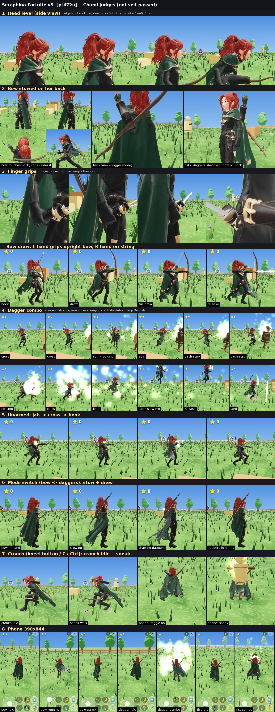

# Seraphina — Fortnite style (v5)

Play: https://nasoteisoy.github.io/seraphina-fortnite/ (works on phone)
Older: v4 https://nasoteisoy.github.io/seraphina-fortnite/v4/ · v3 https://nasoteisoy.github.io/seraphina-fortnite/v3/ · v2 https://nasoteisoy.github.io/seraphina-fortnite/v2/

v5:
- Head level: she looks at the horizon in idle / walk / run (was 12–21° down).
- Bow stowed flat against her back (cape is pushed under it, no gap, no clipping).
- Real finger bones (5 per hand) — fingers wrap the dagger handles and bow grip, open hand on the string, fists when unarmed.
- New dagger combo: cross-slash → spinning reverse-grip slash → dash-stab → leap X-slash finisher (slow-mo, trails, hit-stop, camera punch).
- She holds the active weapon: daggers in both hands, or the bow in the left hand; switching plays a stow + draw.
- Unarmed mode: jab, cross, hook (+ kick) with clenched fists. Switch cycles 🏹 → 🗡️ → ✊.
- Walk ~1.5× faster (1.04 → ~1.55 m/s) with a snappier ramp; feet still matched to the stride.
- Crouch: 🧎 button / C / Ctrl — crouch idle + sneak walk, slower, camera lowers.

Phone: left stick to move (push far = run), icon buttons: 🤸 roll, 🦶 kick, ⬆️ jump, 🧎 crouch, 🔄 switch, attack.
Desktop: WASD move, Shift run, Space jump, F/click attack, X/Tab switch (B bow · J daggers · U fists), K kick, C/Ctrl crouch, R roll.

Dagger combo: [motion.gif](motion.gif) · v4 sheet/gif kept in [v4/](v4/)

---

# Seraphina — Fortnite style (v4)

Play: https://nasoteisoy.github.io/seraphina-fortnite/ (works on phone)
Older: v3 https://nasoteisoy.github.io/seraphina-fortnite/v3/ · v2 https://nasoteisoy.github.io/seraphina-fortnite/v2/

v4:
- No more gliding: feet stay planted during attacks, bow draw and idle (movement locked during attack clips,
  tiny eased lunge only, recovery cancels when you move, walk/run speed matched to the clip stride, foot-lock IK).
- Flowy hair and cape: ponytail bone chains + 5x4 cape bone grid driven by a verlet spring sim
  (gravity, inertia, wind, body collisions, anti-flip limits) — swings on run/turn/stop/jump/attack, settles at idle.
- Render pass: removed the two sticks over her right shoulder and loose slivers, sharper phone rendering (pixel ratio 2),
  tighter shadows, rim light, new ground + bladed grass, nicer training dummies, help bar no longer overlaps buttons.

Phone: left stick to move, icon buttons: 🤸 roll, 🦶 kick, ⬆️ jump, 🔄 switch weapon, 🏹/🗡️ attack (tap 3× for the combo).
Desktop: WASD move, Shift run, Space jump, F attack, X/Tab switch, K kick, C roll.

Before/after motion: [motion.gif](motion.gif) · flaw crops: [flaws.png](flaws.png)
