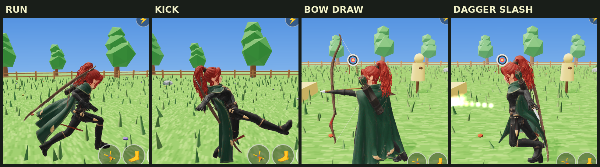

# Seraphina — Fortnite style (v2)

Play v2: https://nasoteisoy.github.io/seraphina-fortnite/v2/ (works on phone)

- Cape re-weighted to spine/chest/shoulders + spring (verlet) motion with leg/hip collision.
- Bow, quiver and both daggers are separate pieces: bow + quiver on her back, daggers in the hip sheaths.
- 🏹 attack: bow moves to the left hand, arrow nocked, drawn, fired, bow back on the back.
- 🗡️ attack: both daggers drawn, slash, sheathed.
- 🔄 button switches weapon. Arrows hit dummies and archery targets; daggers hit dummies up close.

Controls (desktop): WASD move, Shift run, Space jump, F attack, X/Tab switch, K kick, C roll.

